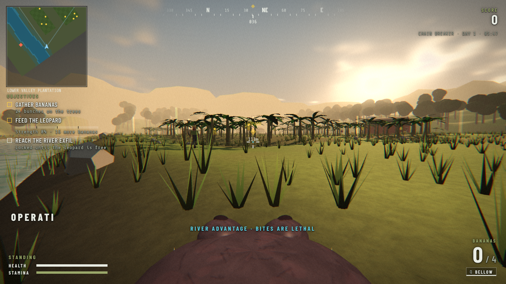

# Hippo Heist

You are a river hippo. A leopard is held captive on the banana farms of the lower valley. Feed him until he is strong enough to break free, and make the farmers regret following you to the water.

## Play Now

https://wickedhardflip.github.io/hippo-heist/

Runs in any modern desktop browser with WebGL. Keyboard and mouse required.

## Controls

| Action | Default keys |
|--------|--------------|
| Move | WASD / Arrow keys |
| Look | Mouse |
| Burst sprint (hold) | Shift |
| Sneak toggle | C / X |
| Bite | Left mouse / Space |
| Bellow lure | Q / Right mouse |
| Feed leopard (hold) | E / F |
| Mute | M |

All keys can be rebound from the Controls panel on the main menu.

## Missions

| # | Operation | Location |
|---|-----------|----------|
| 1 | Chain Breaker | Lower Valley Plantation |
| 2 | Hard Cargo | Cooper Packing Yard |
| 3 | Black Rain | Monsoon Ridge Sawmill |

Four difficulty levels (Recruit, Regular, Hardened, Veteran), power-ups such as Golden Banana, Hot Pepper, Mud Camo and Recon Parrot, and farmers armed with everything from shovels to chainsaws.

## Building

The game ships as a single page. Source lives in `src/`; `build.py` concatenates it:

    python3 build.py

This writes `index.html` (the page GitHub Pages serves), plus `game.html` and `test.html` for local use (both git-ignored). `test.html` expects a local `three.min.js` (Three.js r128) next to it; `index.html` loads Three.js from cdnjs.

## Previous version

The original 2D canvas game is preserved at the `v1-original` tag (also `v1.0.0`) and on the `legacy-2d-original` branch.

## License

MIT License
