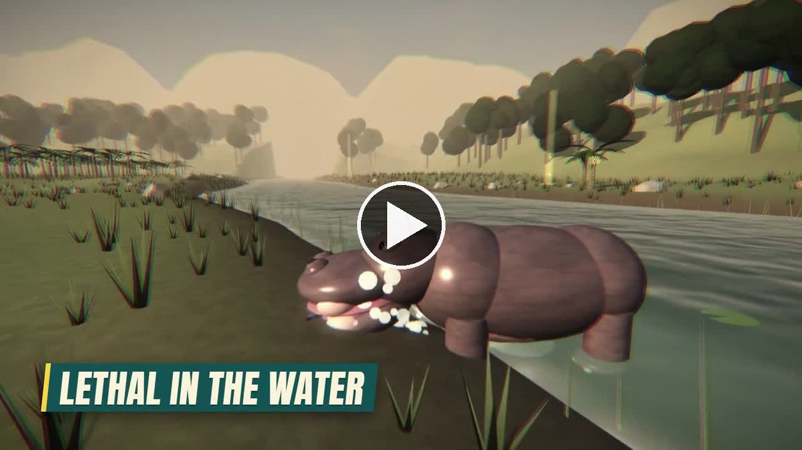
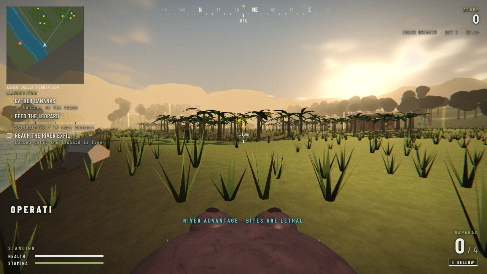
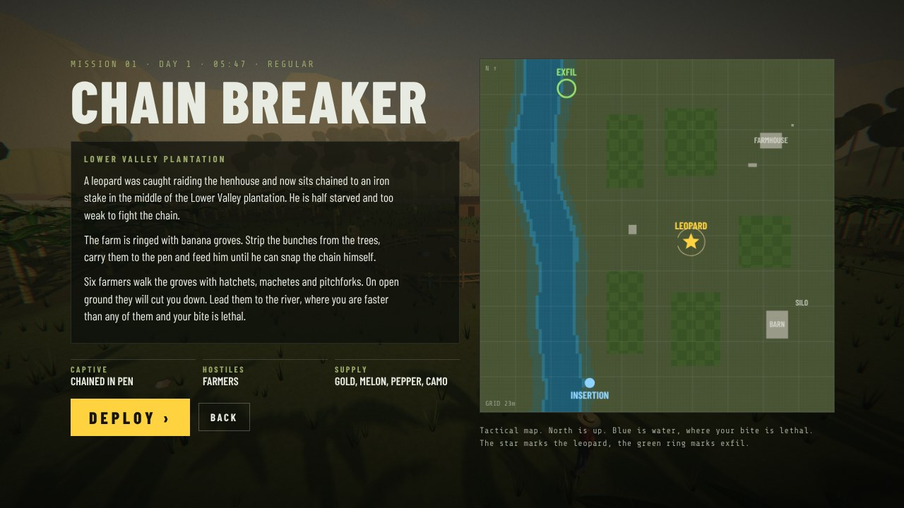
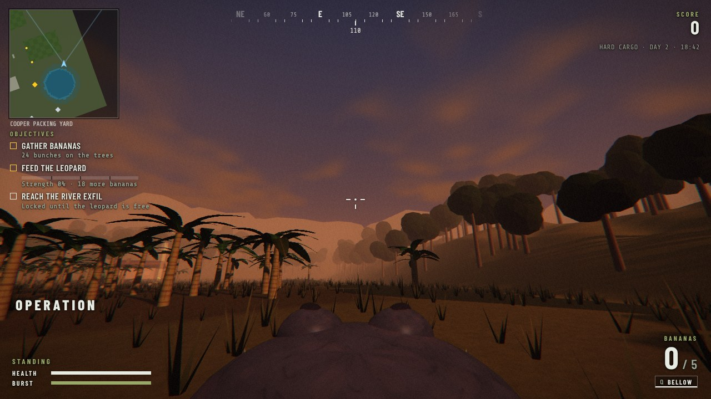
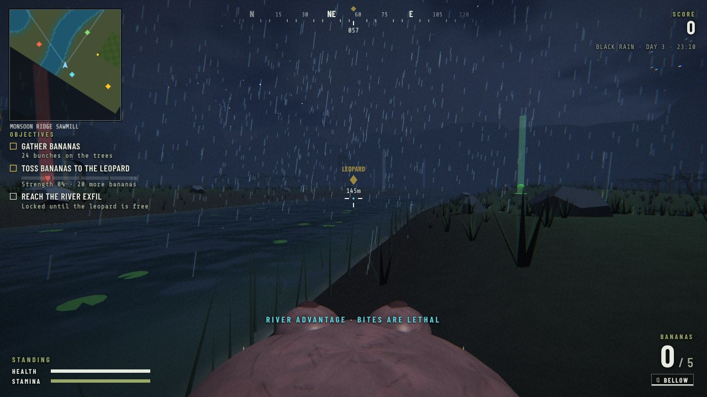
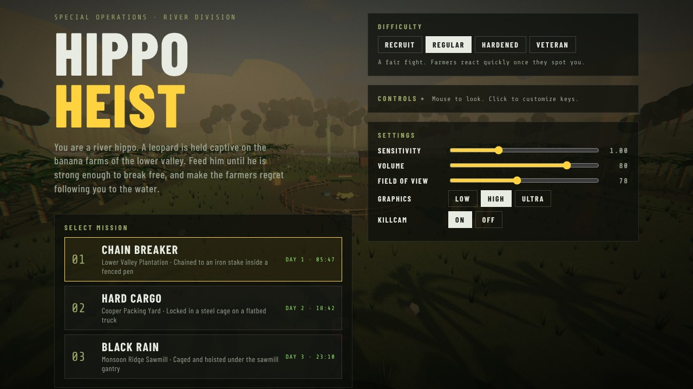

# Hippo Heist

**A first-person stealth heist where you are the hippo.**

Version 2.1 ([changelog](CHANGELOG.md))

The farmers of the lower valley have caught a leopard, and they are starving him in a cage. You are a river hippo with a plan: raid their banana groves, smuggle the fruit to the captive cat, and feed him until he is strong enough to break free. Then get out the way you came in, through the water, where no farmer can keep up and your bite is lethal.

### [▶ Play Hippo Heist in your browser](https://wickedhardflip.github.io/hippo-heist/)

No download, no install. Runs in any modern browser with WebGL. Play with keyboard and mouse on a computer, or with on-screen touch controls on a phone or tablet.

## How to play

Every mission follows the same three objectives, shown in the top left of the screen.

1. **Gather bananas.** Walk up to a banana tree to strip a bunch. You can only carry a few at a time, so plan your runs.
2. **Feed the leopard.** Bring the bananas to the leopard's pen and hold the feed key. Each delivery fills his strength bar. Once it is full, he breaks free.
3. **Reach the river exfil.** The exit unlocks once the leopard is free. Escort him to the green marker to win.

Farmers patrol the farm armed with hatchets, machetes, pitchforks, shovels and the occasional chainsaw, and later missions add guard dogs that bark to call them. On open ground they will cut you down. In the water the odds turn: you are faster than any of them, and a single bite is lethal. The best hippos lure farmers to the riverbank with a bellow and finish them there.

You score points for every banana picked and fed, every power-up collected, every farmer taken down, and a big bonus for freeing the leopard.

### Tips

- Sneaking makes you much harder to spot, and the banana groves give extra cover. Sprinting makes you easier to see, so save your burst for when you are already spotted.
- Bellow to pull a farmer away from a grove, or to draw him toward the water.
- Deep water hides you as well as protecting you. The minimap shows it in blue, so when things go wrong, head for it.
- Stamina drains while sprinting. If you run it dry you are winded and slow, which is a bad time to be on dry land.

## Controls

| Action | Default keys |
|--------|--------------|
| Move | W A S D or arrow keys |
| Look | Mouse |
| Burst sprint (hold) | Shift |
| Sneak (toggle) | C or X |
| Bite | Left mouse or Space |
| Bellow (lure farmers) | Q or right mouse |
| Feed the leopard (hold) | E or F |
| Pause | Esc |
| Mute | M |

On a phone or tablet, on-screen controls appear during play: put your left thumb anywhere on the left side for a move stick, drag on the right side to look, and use the Bite, Feed, Burst, Bellow and Sneak buttons in the bottom right. The pause button sits next to the minimap. Landscape works best, and graphics default to Low on touch devices.

Every key can be rebound from the Controls panel on the main menu. Mouse sensitivity, volume, field of view, graphics quality and the killcam can all be set there too.

## Leaderboard

Each mission has an online leaderboard, which you can open from the main menu or after a win. When you complete a mission, you can post your score under any name you like. The board can be filtered and sorted by difficulty, score, time or name. The backend is a small Cloudflare Worker described in [leaderboard/](leaderboard/README.md).

## Missions

| # | Operation | Location | The leopard |
|---|-----------|----------|-------------|
| 01 | **Chain Breaker** | Lower Valley Plantation, sunrise | Chained to an iron stake inside a fenced pen |
| 02 | **Hard Cargo** | Cooper Packing Yard, dusk | Locked in a steel cage on a flatbed truck |
| 03 | **Black Rain** | Monsoon Ridge Sawmill, midnight storm | Caged and hoisted under the sawmill gantry |
| 04 | **Last Stop** | Millbrook Junction village, night | Caged on a circus train at the village station |

Each mission opens with a briefing and a tactical map showing the water, the leopard and the exfil point.

### Mission 04: Last Stop

The hardest mission moves the heist from the farms into a village. The leopard has been sold to a circus and sits caged on a flatcar of the circus train at the station, and a departure clock counts down until it pulls out. Leopards eat meat, so here you steal hams and sausages from the market stalls, the butcher and the sausage carts instead of bananas.

- **Village police.** Constables patrol the streets with batons and blow their whistles to bring every officer nearby. Two police dogs track you by scent, sergeants with net guns arrive at half strength and tangle you from range (bite to tear free), and the ringmaster comes for his star act with a long whip.
- **Villagers.** Townsfolk walk the streets. If one sees you they scream for the police. You can eat them anywhere for health, but every few you eat brings another constable.
- **Hide in houses.** Every house has an open door. Get inside out of sight and the walls hide you, and you heal faster while you wait for the police to lose your trail.
- **Lamplight.** Street lamps light you up. Keep to the shadows between them.
- **The river.** The river on the west side of the village runs under the railway bridge to the exfil point.

<table>
  <tr>
    <td></td>
    <td></td>
  </tr>
  <tr>
    <td align="center"><em>Hard Cargo</em></td>
    <td align="center"><em>Black Rain</em></td>
  </tr>
</table>

## Difficulty

| Level | What to expect |
|-------|----------------|
| Recruit | Farmers are slow to notice you and hit softly. |
| Regular | A fair fight. Farmers react quickly once they spot you. |
| Hardened | More farmers, sharper eyes, heavier swings. |
| Veteran | The whole valley is armed and awake. Use the water. |

## Power-ups

Look for these scattered around each farm.

| Power-up | Effect |
|----------|--------|
| Golden Banana | Counts as three bananas |
| Watermelon | Restores full health |
| Hot Pepper | Speed boost and endless stamina |
| Mud Camo | Farmers struggle to see you |
| Thick Hide | Armor that absorbs damage |
| Recon Parrot | Every farmer shows on your map |
| Feeding Frenzy | Your bite is lethal anywhere, not just in the water |

## Classic Hippo Heist

The original 2D arcade version, with touch controls for phones, is still playable:

### [▶ Play Hippo Heist Classic](https://wickedhardflip.github.io/hippo-heist/classic/)

Its source is preserved at the `v1-original` tag and on the `legacy-2d-original` branch.

## Building from source

The game ships as a single self-contained page. Source lives in `src/`, and `build.py` stitches it together:

    python3 build.py

The version number lives in the `VERSION` file; `build.py` stamps it into the page title, a meta tag and the main menu.

This writes `index.html`, the page GitHub Pages serves. It also writes `game.html` and `test.html` for local use (both git-ignored). `index.html` loads Three.js r128 from cdnjs; `test.html` expects a local `three.min.js` next to it.

Built with Three.js (WebGL), the Web Audio API for sound, and plain JavaScript.

## License

MIT License. Feel free to use, modify and share.
